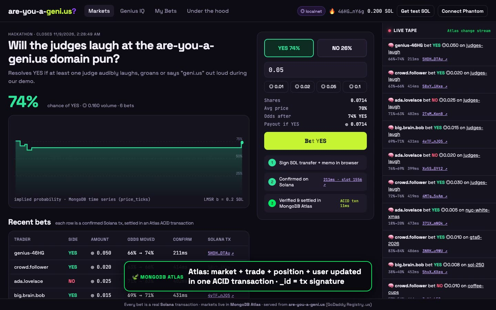
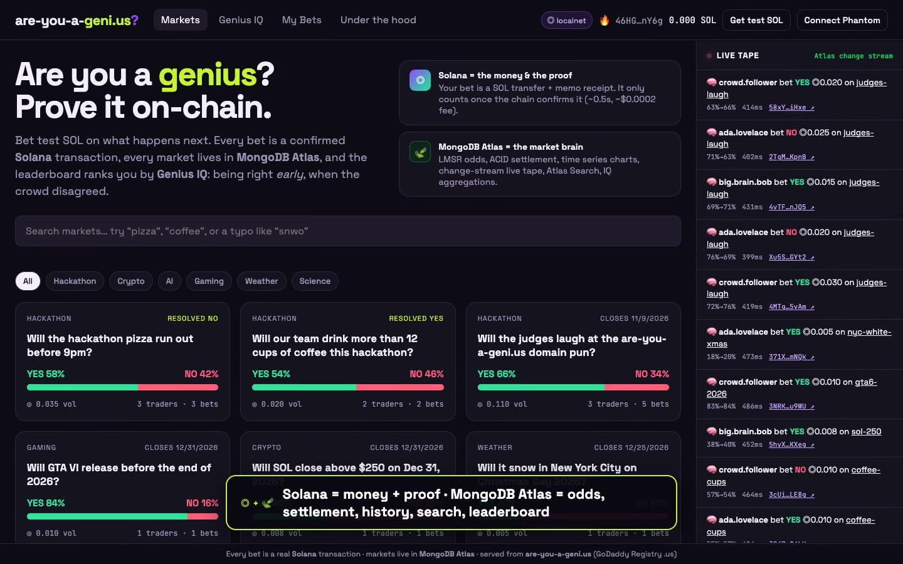
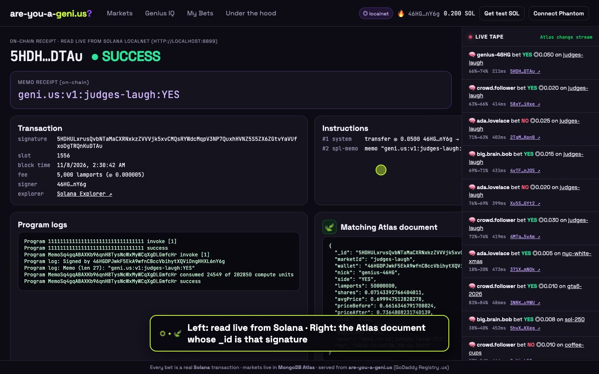
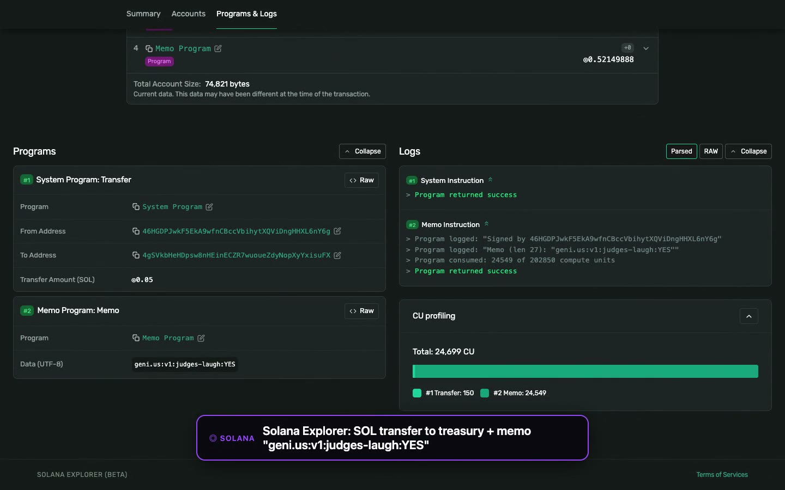
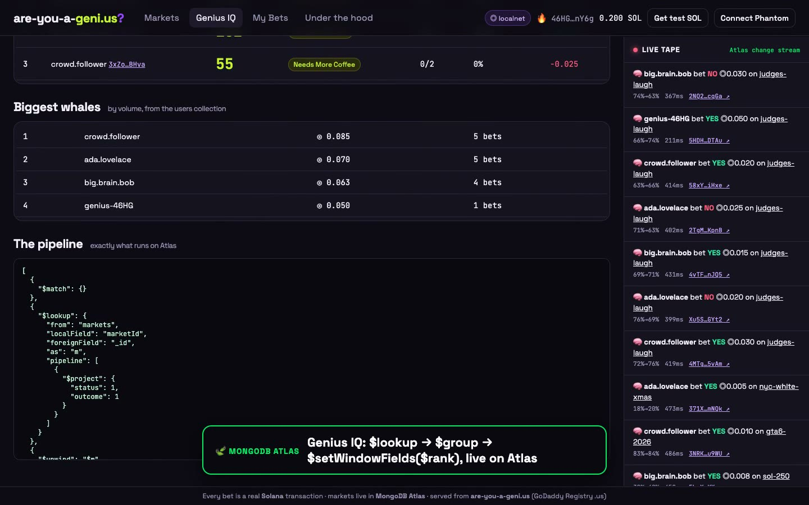

# are-you-a-geni.us 🧠

**Are you a genius? Prove it on-chain.**

A prediction market where every bet is a confirmed **Solana** transaction and every market, trade, price tick and Genius IQ lives in **MongoDB Atlas**. Served from **[are-you-a-geni.us](https://are-you-a-geni.us)**, a `.us` domain registered through **GoDaddy Registry**.

> 🎬 The demo video was recorded against a local `solana-test-validator` + MongoDB Atlas Local. Same code, same transactions. Point `SOLANA_RPC` at devnet and `MONGODB_URI` at Atlas for production.

> Volume doesn't make you a genius. Being right *before* the crowd does. Your **Genius IQ** goes up when you buy cheap and turn out to be right.



📄 Devpost write-up: [`DEVPOST.md`](DEVPOST.md) · 🎬 Demo video: [`video/out/demo.mp4`](video/out/demo.mp4) · 🗣 Script: [`video/SCRIPT.md`](video/SCRIPT.md)

---

## Why both integrations are essential

| | What it does in the product | Remove it and… |
|---|---|---|
| **◎ Solana** | **The money and the proof.** A bet is a `SystemProgram.transfer` to the market treasury plus a **Memo receipt** (`geni.us:v1:<market>:<YES/NO>`), signed in the browser by a burner keypair or Phantom. The server relays it, waits for `confirmed`, **re-reads the parsed tx from the chain** and checks transfer, signer and memo before anything counts. Winners are **paid in SOL** from the treasury in batched on-chain transfers. New users get test SOL from a treasury faucet tx. | …nobody can bet. There's no stake, no receipt and no payout. |
| **🍃 MongoDB Atlas** | **The market brain.** LMSR market-maker state (`qYes`, `qNo`, `b`). **Multi-document ACID transactions** settle market + trade + position + user in one atomic step. Trade `_id` = **Solana signature**, so the same tx can never be counted twice. **Time series** collection (`price_ticks`) for odds charts with `$dateTrunc` bucketing. **Change streams** fanned out over SSE drive the live tape and update odds and charts in every browser. **Atlas Search** (fuzzy + autocomplete) for market discovery, with its index created by the app on boot. **Aggregation pipelines** (`$lookup → $group → $setWindowFields $rank`) compute Genius IQ, and another one computes payouts. TTL index rate-limits the faucet. | …there's no market. No odds, no settlement, no history, no search, no leaderboard. |
| **🌐 GoDaddy Registry** | `are-you-a-geni.us` reads as "are you a genius?" The domain *is* the product's question and its brand. `.us` is operated by GoDaddy Registry. | …it's just another `.vercel.app`. |

## Screenshots

| | |
|---|---|
|  |  |
| Markets + live tape (Atlas change stream) | On-chain receipt read from Solana, next to its Atlas document |
|  |  |
| Solana Explorer: transfer + memo | Genius IQ aggregation pipeline |

## How a bet flows

```
browser (burner keypair or Phantom)
  └─ signs Tx[ SystemProgram.transfer(user → treasury, lamports), Memo("geni.us:v1:judges-laugh:YES") ]
        │  POST /api/trade
server  ├─ sendRawTransaction → Solana devnet → confirmTransaction('confirmed')   (~400–900 ms)
        ├─ getParsedTransaction(sig): verify transfer → treasury, source == signer, memo market/side, amount
        └─ MongoDB Atlas ACID transaction (snapshot read concern, majority write):
              trades.insertOne({_id: signature, …})      ← unique: replaying a tx aborts the txn
              markets.updateOne($inc qYes|qNo, volume)    ← LMSR state = the odds
              positions.updateOne(upsert $inc shares)
              users.updateOne(upsert $inc stats)
           then price_ticks.insertOne (time series)
Atlas change stream (trades + markets) ─► SSE /api/stream ─► every browser: live tape, odds, chart
resolve ─► aggregate winning positions ─► treasury pays winners in SOL (batched transfers + memo) ─► payouts collection
```

## Run it

Requirements: Node 18+ and a MongoDB Atlas cluster (free M0 works). For Solana, pick one:

* **Local validator (zero setup, no faucet needed).** `brew install solana` (or the [Anza installer](https://docs.anza.xyz/cli/install)), run `npm run localnet`, and set `SOLANA_RPC=http://localhost:8899`. The server airdrops the treasury itself on boot. Explorer links open the public Solana Explorer pointed at your local RPC, and every tx also has an in-app receipt page at `/#/tx/<signature>` that reads it straight from the RPC.
* **Devnet.** Keep `SOLANA_RPC=https://api.devnet.solana.com` and fund the treasury at https://faucet.solana.com. The devnet RPC airdrop is closed.

```bash
npm install
cp .env.example .env          # paste your Atlas URI into MONGODB_URI, set ADMIN_KEY
npm run wallet                # creates the treasury keypair (devnet: fund it at faucet.solana.com; localnet: automatic)
npm run seed                  # inserts the markets
npm start                     # http://localhost:3000
```

* The Atlas Search index (`markets_search`) is created automatically on first boot and is queryable in about a minute. Until then search falls back to `$regex`.
* Resolve markets and pay winners at `/admin.html` with your `ADMIN_KEY`.
* **No Atlas handy?** `npm run dev:local` runs against `MONGODB_URI` if it's set (for example the official `mongodb/mongodb-atlas-local` Docker image, which supports Atlas Search), otherwise against an in-memory replica set.

```bash
docker run -d -p 27027:27017 mongodb/mongodb-atlas-local:8   # MONGODB_URI=mongodb://localhost:27027/?directConnection=true
```

## Deploy on the domain

It's a long-running Node server (change streams + SSE), so it needs a real host, not serverless. `render.yaml` makes Render a one-click deploy.

1. **Atlas:** create a free M0 cluster, add a database user, and allow `0.0.0.0/0` under Network Access (Render's IPs aren't fixed). Copy the `mongodb+srv://` URI.
2. **Treasury:** fund the address from `npm run wallet` with devnet SOL at https://faucet.solana.com (signing in with GitHub skips the captcha).
3. **Render:** New → Blueprint → this repo. Paste `MONGODB_URI`, `TREASURY_SECRET_KEY` (from your `.env`) and an `ADMIN_KEY`. It seeds the markets and creates the Atlas Search index on first boot.
4. **Domain:** Render → Settings → Custom Domains → add `are-you-a-geni.us` and `www.are-you-a-geni.us`. At your registrar (GoDaddy DNS), set the apex `A` record and the `www` `CNAME` to the values Render shows. HTTPS is issued automatically.

Render's free plan sleeps after 15 idle minutes (the first request then takes ~1 min), so open the site before judging or use the Starter plan.

## Re-record the demo video

```bash
node video/prep.js http://localhost:3100     # bot traders place real Solana bets, 2 markets resolve + pay out
node video/record.js --export-script         # writes video/out/narration.json
python video/tts.py af_heart 1.18            # Kokoro neural TTS -> video/voice/s00.wav … (see header for setup)
node video/record.js http://localhost:3100   # drives Chrome, uses video/voice/* clips (falls back to `say`), writes video/out/demo.mp4
```

To narrate it yourself, drop your own per-scene clips into `video/voice/` (`s00.m4a` …) and rerun the last command. Scene timing follows your clips. See [`video/SCRIPT.md`](video/SCRIPT.md).

## Stack

Node.js · Express · MongoDB Atlas (Node driver 6: transactions, change streams, time series, Atlas Search, aggregation) · Solana web3.js (devnet / localnet, System Program, Memo Program) · vanilla JS front end · Playwright + ffmpeg for the demo video.

MIT licensed.
